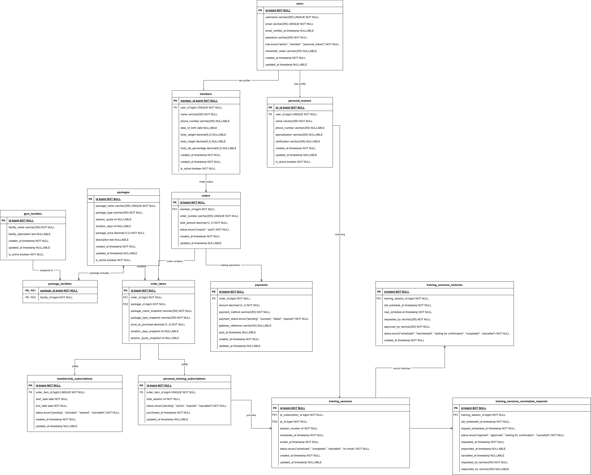

# EriFit — Gym & Fitness Center Management System

**EriFit** is a web-based gym operations and membership management system built with **Laravel 12** and **PostgreSQL**. This project is developed from the ground up with a focus on clean backend architecture, relational database integrity, and role-based access control (RBAC).

**(STILL WORK IN PROGRESS)**
---

## Tech Stack

- **Backend:** PHP 8.3.36, Laravel 12.
- **Database:** PostgreSQL
- **Frontend:** Blade Components, Tailwind CSS, Vite
- **Version Control:** Git/GitHub

---

## Core Features & Architecture

- **Multi-Role Authentication & Authorization (RBAC):**
  - **Admin:** Back-office workspace (`<x-admin-layout>`) to manage membership packages, gym facilities, members, personal trainers, orders, and payment verifications.
  - **Member:** Self-service portal (`<x-layout>`) for profile & body metrics tracking (`body_weight`, `body_height`, `body_fat_percentage`), package purchases, active subscriptions, and PT session bookings.
  - **Personal Trainer:** Session schedule management and approval workflow for member reschedule requests.
- **Relational Database Design (14 Tables):**
  - **Master & User Profiles:** `users`, `members` (custom PK `member_id`), `personal_trainers` (custom PK `pt_id`), `packages`, `gym_facilities`, and `package_facilities`.
  - **Transactions & Historical Snapshots:** `orders`, `order_items` (preserves `package_name_snapshot`, `price_at_purchase`, `duration_days_snapshot`, and `session_quota_snapshot` so historical invoices remain accurate even if package prices change), and `payments`.
  - **Subscriptions & Coaching:** `membership_subscriptions`, `personal_training_subscriptions`, `training_sessions`, `training_sessions_histories`, and `training_sessions_reschedule_requests`.



---

## Project Status

- [x] Database schema & ERD design (14 relational tables)
- [x] Multi-role authentication & custom `RoleMiddleware` (`admin`, `member`, `personal_trainer`)
- [x] Separated role-based route groups & Blade layout components
- [ ] Database migrations, Eloquent models & relationships *(In Progress)*
- [ ] Admin Master Data CRUD (`packages` & `gym_facilities`)
- [ ] Order checkout, payment flow & subscription activation
- [ ] PT session scheduling & reschedule approval workflow

---

## Local Setup

1. **Clone the repository**
   ```bash
   git clone [https://github.com/erikmaulanahardi/erifit.git](https://github.com/erikmaulanahardi/erifit.git)
   cd erifit
